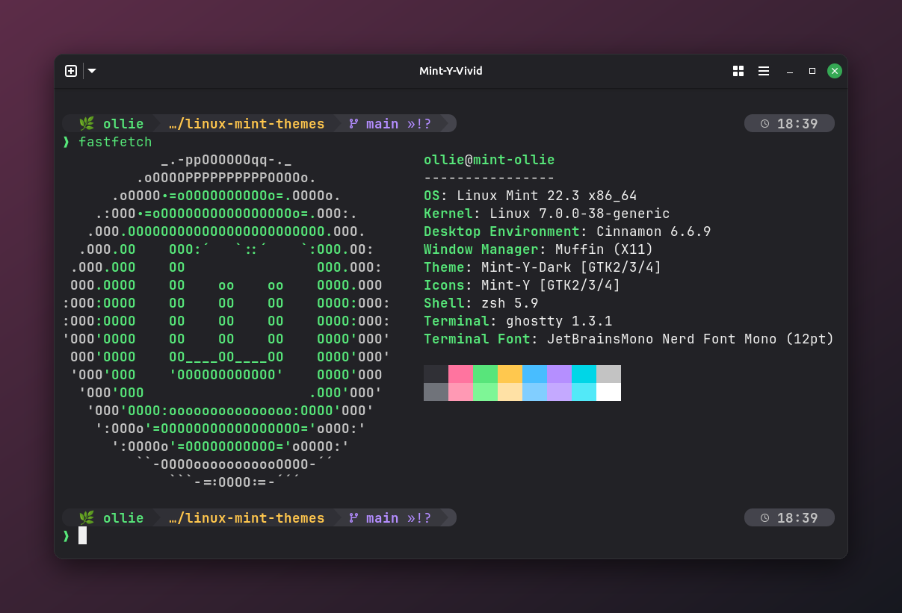
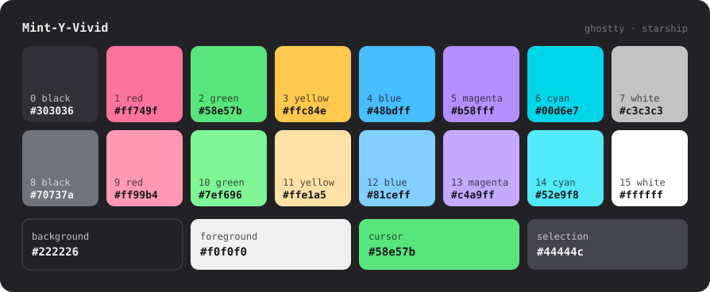
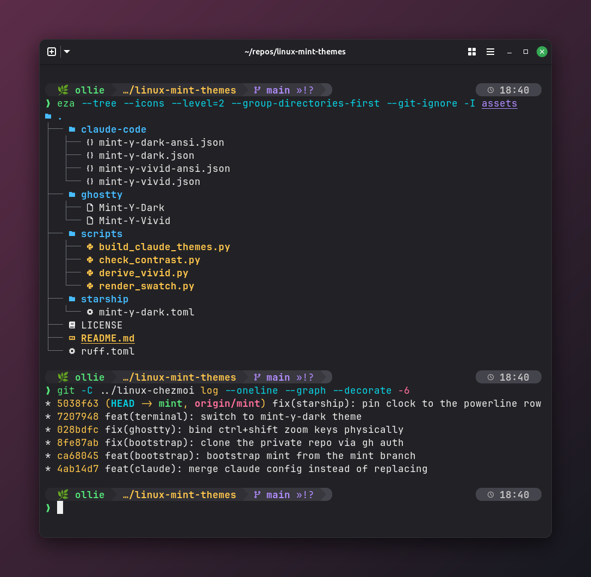
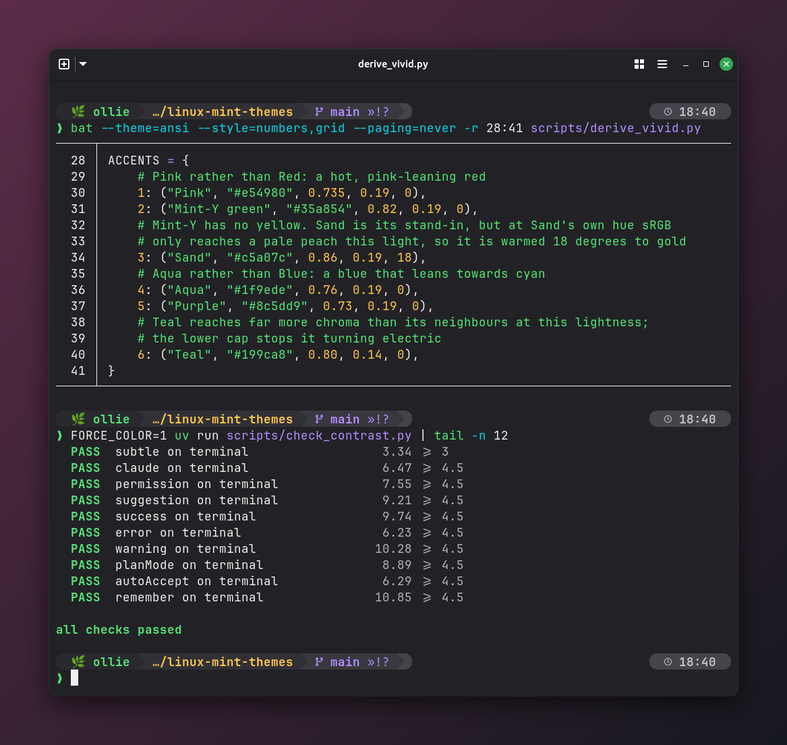
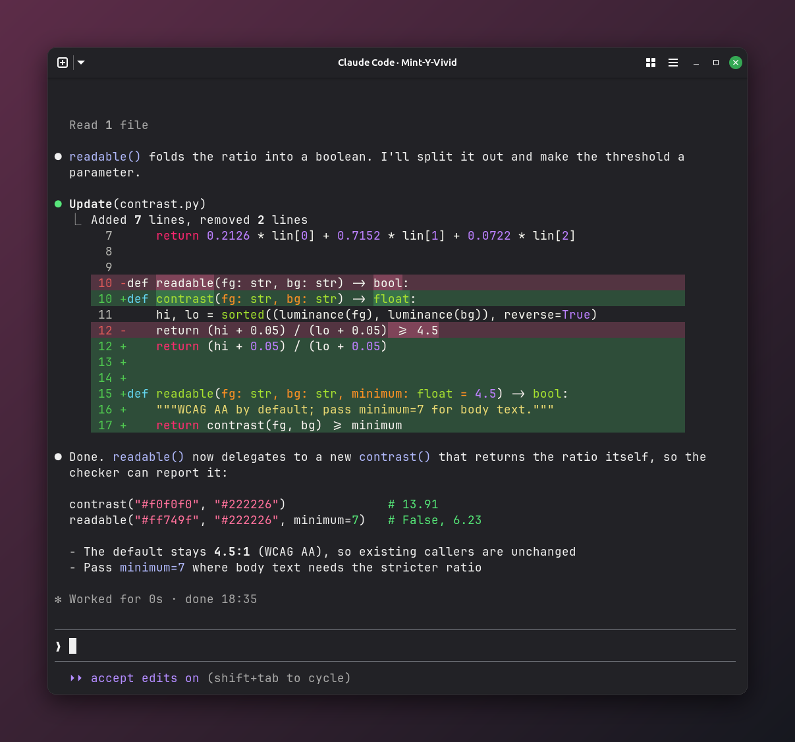
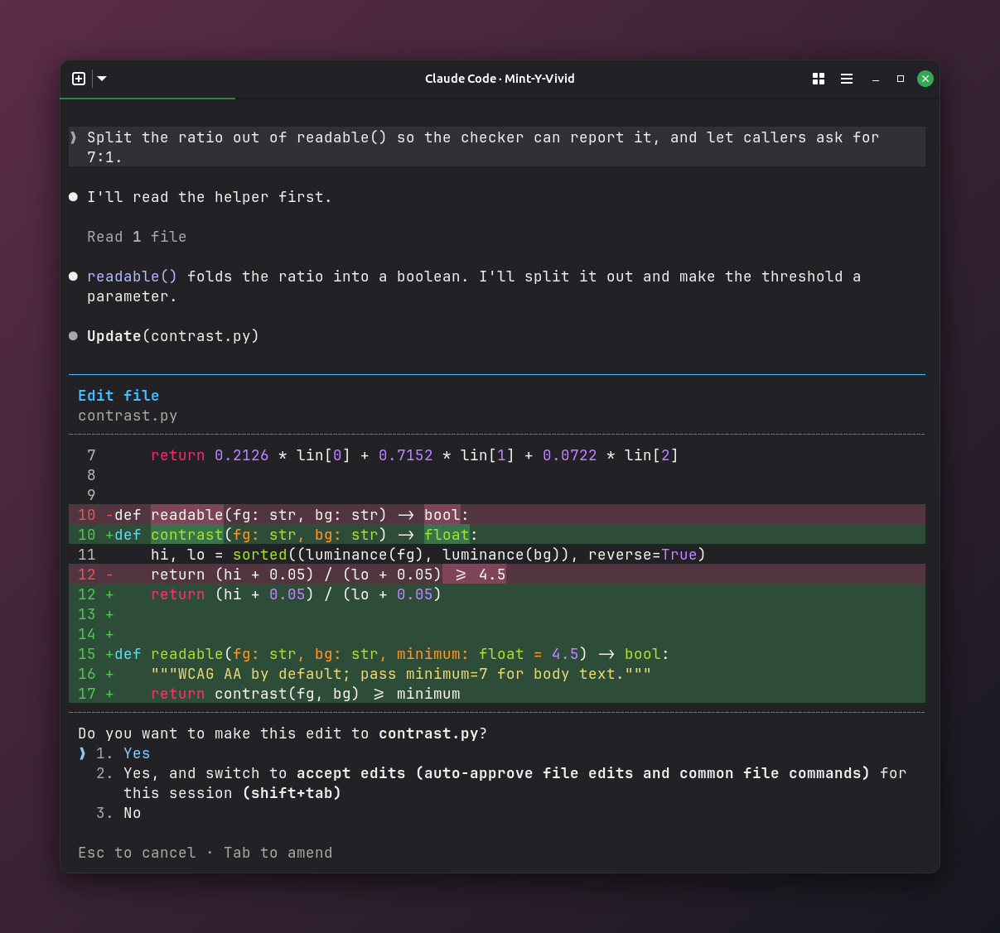
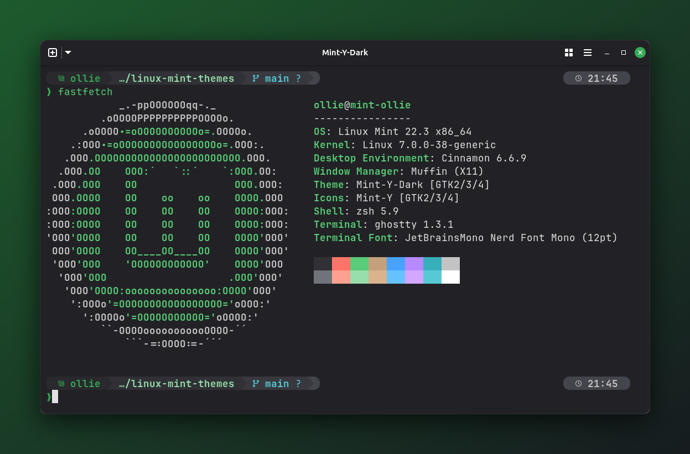
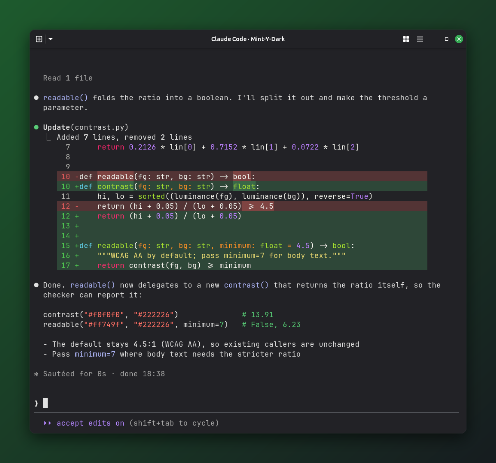

<div align="center">

# Mint-Y for your terminal

**Linux Mint's Mint-Y colours, carried into [Ghostty](https://ghostty.org), [Starship](https://starship.rs) and [Claude Code](https://claude.com/claude-code).**
Your terminal stops looking like a guest on the Cinnamon desktop and starts looking like part of it.



</div>

Two themes share Mint-Y-Dark's greys, so either one fuses with the window's title bar on Cinnamon:

- **[Mint-Y-Vivid](#mint-y-vivid)**: rich, saturated accents in the style of Monokai Pro, every hue taken from Mint-Y.
- **[Mint-Y-Dark](#mint-y-dark-the-muted-alternative)**: the muted original, Mint-Y's accents lifted only as far as readability needs.

## Mint-Y-Vivid



Monokai Pro is the styling hint: every accent pushed to rich, saturated colour at a similar brightness, so the six read as one vivid family. The red leans pink, the blue leans cyan, and orange is a sixth accent. No Monokai Pro colour values are used. Every hue comes from one of Mint-Y's own accents, held fixed in OKLCH, and only lightness and chroma move:

| Slot | From Mint-Y | Regular | Bright |
|---|---|---|---|
| 1 red | **Pink** `#e54980` | `#ff749f` | `#ff99b4` |
| 2 green | the Mint-Y accent `#35a854` | `#58e57b` | `#7ef696` |
| 3 yellow | **Sand** `#c5a07c`, warmed 18° to gold | `#ffc84e` | `#ffe1a5` |
| 4 blue | **Aqua** `#1f9ede` | `#48bdff` | `#81ceff` |
| 5 magenta | **Purple** `#8c5dd9` | `#b58fff` | `#c4a9ff` |
| 6 cyan | **Teal** `#199ca8` | `#00d6e7` | `#52e9f8` |
| orange | **Orange** `#ff7139` (outside the ANSI 16) | `#ff8254` | `#ffa382` |

Mint-Y has no yellow. Sand is its stand-in, but at Sand's own hue sRGB only reaches a pale peach this light, so Vivid's yellow is the one hue that moves. Each accent sits just above the 6:1 contrast floor, at the most chroma sRGB allows there. The background, black and white slots, and selection are Mint-Y-Dark's greys.

The palette is generated: [`scripts/derive_vivid.py`](scripts/derive_vivid.py) holds the sources and targets and writes [`ghostty/Mint-Y-Vivid`](ghostty/Mint-Y-Vivid).





## Ghostty

Copy a theme into Ghostty's themes directory and select it:

```sh
mkdir -p ~/.config/ghostty/themes
cp ghostty/Mint-Y-Vivid ghostty/Mint-Y-Dark ~/.config/ghostty/themes/
echo 'theme = Mint-Y-Vivid' >> ~/.config/ghostty/config
```

Reload with <kbd>Ctrl</kbd>+<kbd>Shift</kbd>+<kbd>,</kbd>.

## Starship

[`starship/mint-y-dark.toml`](starship/mint-y-dark.toml) is a complete prompt: a fused powerline "rail" that steps up through Cinnamon's panel greys. It runs OS badge and user → directory → git → toolchains, with command duration and a clock pinned to the right of the same line. It needs a [Nerd Font](https://www.nerdfonts.com/). The screenshots use JetBrainsMono Nerd Font Mono.

Starship doesn't take its colours from the terminal theme: every segment uses a fixed palette. The file ships one palette per theme and uses `mint_y_vivid` by default.

To use the whole prompt:

```sh
cp starship/mint-y-dark.toml ~/.config/starship.toml
```

To keep your own prompt and use only the colours, copy a `[palettes.*]` block from the bottom of that file into your config and set:

```toml
palette = 'mint_y_vivid'   # or 'mint_y_dark'
```

| Key | Used for | `mint_y_vivid` | `mint_y_dark` |
|---|---|---|---|
| `rail0`–`rail3` | segment backgrounds, darkest first | `#29292e` `#303036` `#38383e` `#44444c` | same |
| `os_fg`, `ok` | OS badge, user, success prompt | `#58e57b` | `#35a854` |
| `dir_fg` | directory | `#ffc84e` | `#98deab` |
| `git_fg` | branch and status | `#b58fff` | `#56c9d5` |
| `lang_fg` | toolchain versions | `#48bdff` | `#51c3ff` |
| `dur_fg` | command duration | `#ff8254` | `#d9b38e` |
| `clock_fg` | clock | `#c3c3c3` | `#c3c3c3` |
| `alert` | root user, error prompt | `#ff749f` | `#ff7469` |
| `vim` | vi-mode prompt | `#00d6e7` | `#51c3ff` |

## Claude Code



Each Ghostty theme has a matching [Claude Code custom theme](https://code.claude.com/docs/en/terminal-config#create-a-custom-theme) in [`claude-code/`](claude-code), in two variants:

| File | Base | What it does |
|---|---|---|
| `mint-y-vivid.json`, `mint-y-dark.json` | `dark` | Exact colours, softly tinted diffs. Works in any terminal. Code blocks use Claude Code's built-in Monokai-style syntax colours, which a custom theme can't change. **Recommended.** |
| `mint-y-vivid-ansi.json`, `mint-y-dark-ansi.json` | `dark-ansi` | Accents and code blocks follow the terminal's palette, so pair it with the matching Ghostty theme. ANSI themes render in 256 colours, so diffs use the classic dark green and red. |

Mint-Y-Vivid's brand colour (spinner, Claude label) is Mint-Y Orange, close to Claude Code's own; Mint-Y-Dark's is the Mint-Y green.

Install by linking the files into `~/.claude/themes/` (links keep them current with this repo), then pick one with `/theme`:

```sh
mkdir -p ~/.claude/themes
for f in claude-code/*.json; do ln -sf "$PWD/$f" ~/.claude/themes/; done
```

Or set it directly in `~/.claude/settings.json`:

```json
{ "theme": "custom:mint-y-vivid" }
```



## Mint-Y-Dark: the muted alternative




Nothing here was picked by eye. Every colour traces back to Mint-Y-Dark as Linux Mint ships it (`/usr/share/themes/Mint-Y-Dark*`):

| Role | From Mint-Y-Dark | Value |
|---|---|---|
| Background | window title bar and menus (`wm_bg`): the terminal fuses with its own title bar | `#222226` |
| Foreground | Cinnamon panel and menu text | `#e1e1e1` |
| Cursor | the Mint-Y accent itself | `#35a854` |
| Selection | the accent's pressed state | `#1d5a2d` |
| Green | accent hover → pale mint | `#5acb78` / `#98deab` |
| Red, Yellow, Blue, Magenta, Cyan | Mint-Y's official **Red, Sand, Blue, Purple and Teal** accents | lifted, see below |
| Black / white | Cinnamon's panel greys | `#303036` … `#ffffff` |

Mint's accents are designed for white text on a coloured button, not for coloured text on a dark grey. Used as they are, several would be hard to read in a terminal. Each one is lifted in OKLCH lightness **with the hue held fixed** until it reads cleanly, so it stays recognisably the same Mint colour.





## Design rules

These rules are enforced by [`scripts/check_contrast.py`](scripts/check_contrast.py) for every theme:

- Every regular colour (1–6) clears **WCAG 6:1** contrast on the background, and every bright twin (9–14) does too.
- Each bright colour is **lighter** than its regular twin: highlights come from lightness, not a hue shift.
- Character lives in 1–6. Black and white (0, 7, 15) are never relied on for meaning.
- Every Starship segment's text clears **4.5:1** on the grey it sits on.
- In Claude Code, text clears **7:1** on message backgrounds and **6:1** on diff lines, and every accent clears **4.5:1** on the terminal background. Word highlights clear 4.5:1, or 3.5:1 in the 256-colour ANSI variants, where the colour cube has nothing between its two darkest greens.

```sh
uv run scripts/check_contrast.py   # exits non-zero if any rule breaks
```

## Repository layout

```
ghostty/Mint-Y-Vivid          Ghostty theme (generated by derive_vivid.py)
ghostty/Mint-Y-Dark           Ghostty theme
starship/mint-y-dark.toml     Starship prompt + both palettes
claude-code/*.json            Claude Code themes (generated by build_claude_themes.py)
scripts/derive_vivid.py       derives Mint-Y-Vivid from Mint-Y's accents
scripts/build_claude_themes.py  builds the Claude Code themes from the Ghostty themes
scripts/check_contrast.py     design-rule checker (uv script, stdlib only)
scripts/render_swatch.py      regenerates assets/<theme>/palette.svg
assets/<theme>/               screenshots and the palette swatch
```

After changing a colour, regenerate everything and check it:

```sh
uv run scripts/derive_vivid.py && uv run scripts/build_claude_themes.py \
  && uv run scripts/render_swatch.py && uv run scripts/check_contrast.py
```

## Credits

Colours come from [linuxmint/mint-themes](https://github.com/linuxmint/mint-themes). Mint-Y-Vivid's styling is inspired by [Monokai Pro](https://monokai.pro); it uses none of its colour values. The Ghostty themes' structure and design rules follow [Julia Evans on terminal colours](https://jvns.ca/blog/2024/10/01/terminal-colours/) and [ce9e.org on building terminal colour schemes](https://blog.ce9e.org/posts/2019-06-24-terminal-colors/). The Claude Code theme files validate against the [claude-themes](https://github.com/matcra587/claude-themes) schema.

This is an unofficial fan project, not affiliated with or endorsed by Linux Mint, Monokai or Anthropic. "Linux Mint" and "Monokai Pro" are trademarks of their respective owners.

## License

[MIT](LICENSE)
