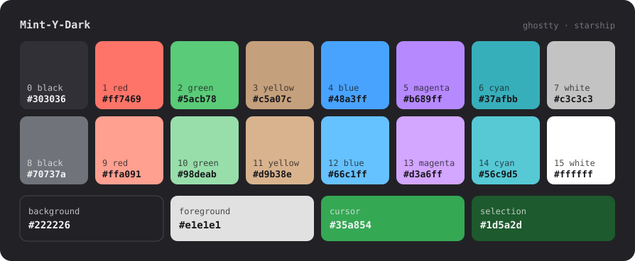
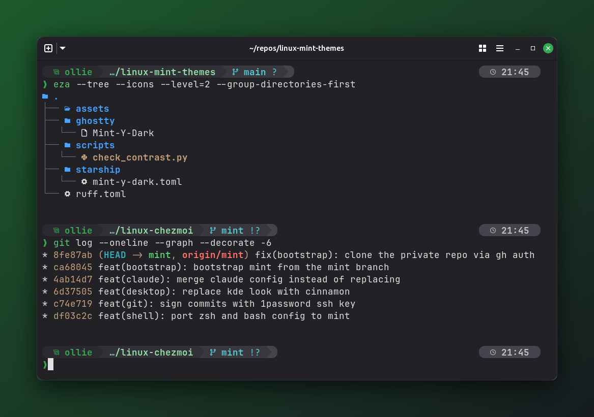
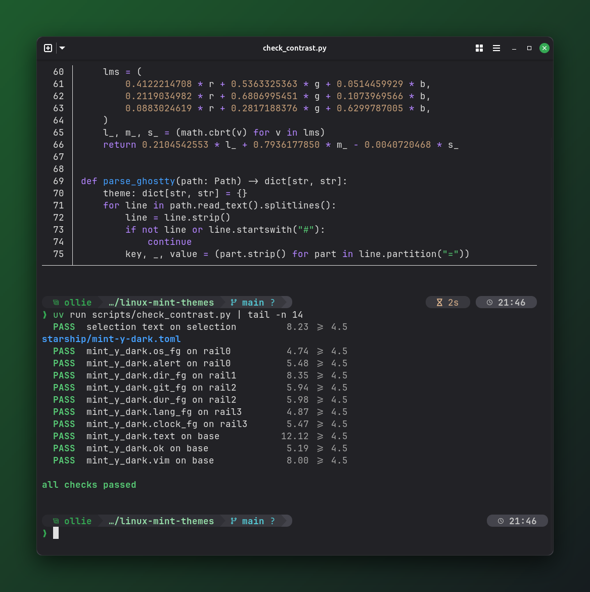

<div align="center">

# Mint-Y-Dark for your terminal

**Linux Mint's own Mint-Y-Dark colours, carried into [Ghostty](https://ghostty.org) and [Starship](https://starship.rs).**
Your terminal stops looking like a guest on the Cinnamon desktop and starts looking like part of it.


</div>

## The palette



Nothing here was picked by eye. Every colour traces back to Mint-Y-Dark as Linux Mint ships it (`/usr/share/themes/Mint-Y-Dark*`):

| Role | From Mint-Y-Dark | Value |
|---|---|---|
| Background | window title bar and menus (`wm_bg`): the terminal fuses with its own title bar | `#222226` |
| Foreground | Cinnamon panel and menu text | `#e1e1e1` |
| Cursor | the Mint-Y accent itself | `#35a854` |
| Selection | the accent's pressed state | `#1d5a2d` |
| Green | accent hover → pale mint | `#5acb78` / `#98deab` |
| Red, Yellow, Blue, Magenta, Cyan | Mint-Y's official **Red, Sand, Blue, Purple and Teal** accents | lifted, see below |
| Black / white | Cinnamon's panel greys | `#303036` … `#ffffff` |

Mint's accents are designed for white text on a coloured button, not for coloured text on a dark grey. Used as they are, several would be hard to read in a terminal. Each one is lifted in OKLCH lightness **with the hue held fixed** until it reads cleanly, so it stays recognisably the same Mint colour.

### Design rules

These rules are enforced by [`scripts/check_contrast.py`](scripts/check_contrast.py):

- Every regular colour (1–6) clears **WCAG 6:1** contrast on the background, and every bright twin (9–14) does too.
- Each bright colour is **lighter** than its regular twin: highlights come from lightness, not a hue shift.
- Character lives in 1–6. Black and white (0, 7, 15) are never relied on for meaning.
- Every Starship segment's text clears **4.5:1** on the grey it sits on.

```sh
uv run scripts/check_contrast.py   # exits non-zero if any rule breaks
```

## Ghostty

Copy the theme into Ghostty's themes directory and select it:

```sh
mkdir -p ~/.config/ghostty/themes
cp ghostty/Mint-Y-Dark ~/.config/ghostty/themes/
echo 'theme = Mint-Y-Dark' >> ~/.config/ghostty/config
```

Reload with <kbd>Ctrl</kbd>+<kbd>Shift</kbd>+<kbd>,</kbd>.

## Starship



[`starship/mint-y-dark.toml`](starship/mint-y-dark.toml) is a complete prompt: a fused powerline "rail" that steps up through Cinnamon's panel greys. It runs OS badge and user → directory → git → toolchains, with command duration and a clock pinned to the right of the same line. It needs a [Nerd Font](https://www.nerdfonts.com/). The screenshots use JetBrainsMono Nerd Font Mono.

To use the whole prompt:

```sh
cp starship/mint-y-dark.toml ~/.config/starship.toml
```

To keep your own prompt and use only the colours, copy the `[palettes.mint_y_dark]` block from the bottom of that file into your config and set:

```toml
palette = 'mint_y_dark'
```

| Key | Used for | Value |
|---|---|---|
| `rail0`–`rail3` | segment backgrounds, darkest first | `#29292e` `#303036` `#38383e` `#44444c` |
| `os_fg`, `ok` | OS badge, user, success prompt | `#35a854` |
| `dir_fg` | directory | `#98deab` |
| `git_fg` | branch and status | `#56c9d5` |
| `lang_fg`, `vim` | toolchain versions, vi-mode prompt | `#51c3ff` |
| `dur_fg` | command duration | `#d9b38e` |
| `clock_fg` | clock | `#c3c3c3` |
| `alert` | root user, error prompt | `#ff7469` |



## Repository layout

```
ghostty/Mint-Y-Dark          Ghostty theme
starship/mint-y-dark.toml    Starship prompt + palette
scripts/check_contrast.py    design-rule checker (uv script, stdlib only)
scripts/render_swatch.py     regenerates assets/palette.svg from the theme
assets/                      screenshots and the palette swatch
```

After changing a colour, run both scripts:

```sh
uv run scripts/check_contrast.py && uv run scripts/render_swatch.py
```

## Credits

Colours come from [linuxmint/mint-themes](https://github.com/linuxmint/mint-themes). The Ghostty theme's structure and design rules follow [Julia Evans on terminal colours](https://jvns.ca/blog/2024/10/01/terminal-colours/) and [ce9e.org on building terminal colour schemes](https://blog.ce9e.org/posts/2019-06-24-terminal-colors/).

This is an unofficial fan project, not affiliated with or endorsed by Linux Mint. "Linux Mint" is a trademark of its respective owners.

## License

[MIT](LICENSE)
